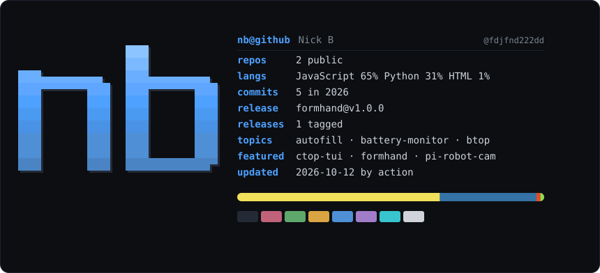

  

  

  repos &nbsp;<a href="https://github.com/fdjfnd222dd/ctop-tui">ctop-tui</a> &middot; <a href="https://github.com/fdjfnd222dd/formhand">formhand</a> &middot; <a href="https://github.com/fdjfnd222dd/pi-robot-cam">pi-robot-cam</a>

