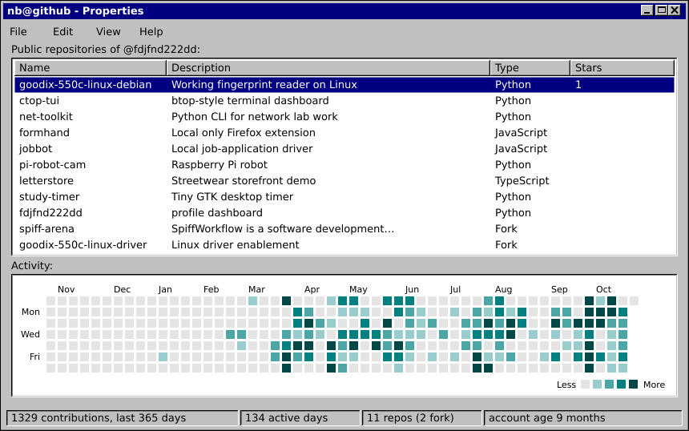

  

  

  repos &nbsp;<a href="https://github.com/fdjfnd222dd/goodix-550c-linux-debian">goodix-550c-linux-debian</a> &middot; <a href="https://github.com/fdjfnd222dd/ctop-tui">ctop-tui</a> &middot; <a href="https://github.com/fdjfnd222dd/net-toolkit">net-toolkit</a> &middot; <a href="https://github.com/fdjfnd222dd/formhand">formhand</a> &middot; <a href="https://github.com/fdjfnd222dd/jobbot">jobbot</a> &middot; <a href="https://github.com/fdjfnd222dd/pi-robot-cam">pi-robot-cam</a>

